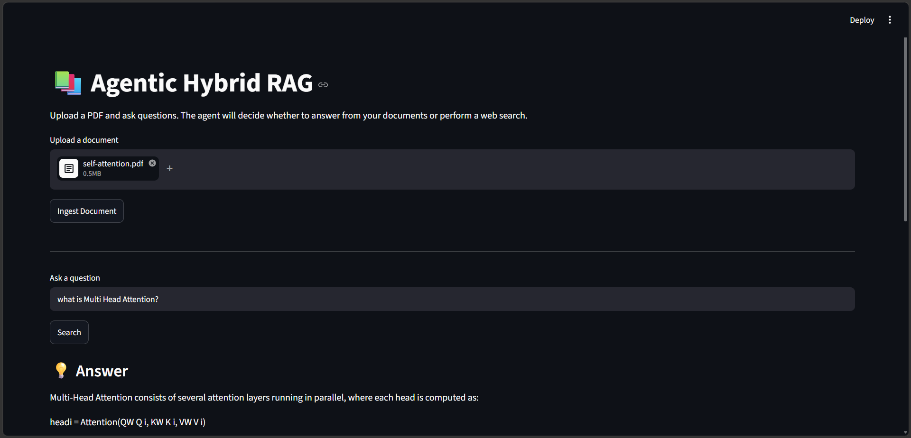
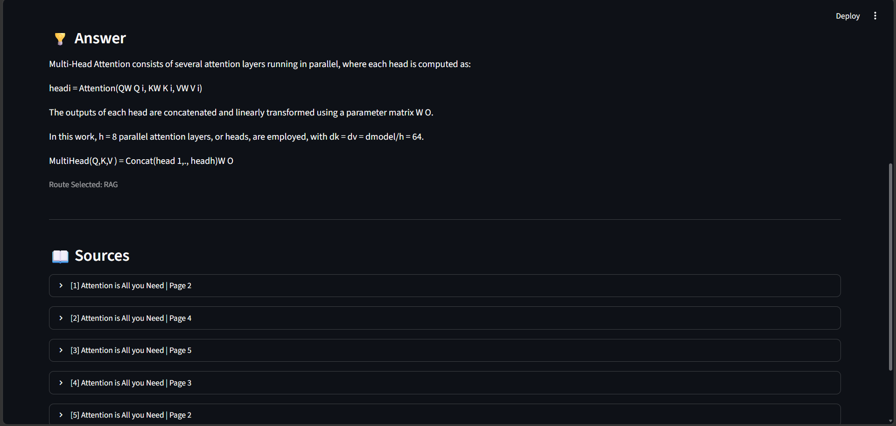

# 📚 Hybrid Search RAG with LangGraph & MongoDB

A production-style Retrieval-Augmented Generation (RAG) application that combines **Hybrid Search (Vector + BM25)**, **Reciprocal Rank Fusion (RRF)**, **Reranking**, and **LangGraph Agentic Workflow** to answer questions from uploaded documents with source citations.

---

## 🚀 Features

- 📄 Upload multiple document types
  - PDF
  - DOCX
  - TXT
  - CSV
  - HTML

- 🧹 Document preprocessing

- ✂️ Semantic Chunking

- 🧠 HuggingFace Embeddings

- 🗄 MongoDB Atlas Vector Search

- 🔍 Hybrid Retrieval
  - Vector Search
  - Keyword Search (BM25)
  - Reciprocal Rank Fusion (RRF)
  - Reranking

- 🤖 Agentic RAG using LangGraph
  - LLM-based Router
  - Hybrid RAG Tool
  - Web Search Tool (Tavily)
  - Answer Generation

- 📖 Source Citations

- 🌐 Streamlit Web Interface

---

## 📸 Screenshots

### Home Page



---

### Answer & Citation Document



---

# Architecture

```text
                   User
                     │
                     ▼
               Streamlit UI
                     │
                     ▼
               LangGraph Agent
                     │
          ┌──────────┴──────────┐
          │                     │
          ▼                     ▼
   Hybrid MongoDB RAG      Web Search
          │                     │
          └──────────┬──────────┘
                     ▼
                Gemini LLM
                     │
                     ▼
             Answer + Citations
```

---

# Project Structure

```text
Hybrid_Search_RAG/

├── agents/
│   ├── graph.py
│   ├── nodes.py
│   ├── prompts.py
│   ├── state.py
│   └── tools.py
│
├── database/
│   └── mongodb.py
│
├── ingestion/
│   ├── loader.py
│   ├── preprocessing.py
│   ├── chunker.py
│   ├── embedding.py
│   └── ingestion.py
│
├── llm/
│   └── model.py
│
├── rag/
│   ├── chain.py
│   └── prompt.py
│
├── retrieval/
│   ├── vector_search.py
│   ├── keyword_search.py
│   └── hybrid_search.py
│
├── app.py
├── config.py
├── requirements.txt
└── README.md
```

---

# Tech Stack

| Category | Technology |
|----------|------------|
| Language | Python |
| Frontend | Streamlit |
| LLM | Google Gemini |
| Agent Framework | LangGraph |
| RAG Framework | LangChain |
| Embeddings | HuggingFace (all-MiniLM-L6-v2) |
| Vector Database | MongoDB Atlas |
| Vector Search | MongoDB Atlas Vector Search |
| Keyword Search | BM25 |
| Rank Fusion | Reciprocal Rank Fusion (RRF) |
| Web Search | Tavily |
| Deployment | Streamlit Community Cloud |

---

# Installation

Clone the repository

```bash
git clone https://github.com/your-username/Hybrid_Search_RAG.git

cd Hybrid_Search_RAG
```

Create virtual environment

```bash
python -m venv venv
```

Activate

Windows

```bash
venv\Scripts\activate
```

Linux / Mac

```bash
source venv/bin/activate
```

Install dependencies

```bash
pip install -r requirements.txt
```

---

# Environment Variables

Create a `.env` file.

```env
MONGODB_URI=your_mongodb_connection_string

GOOGLE_API_KEY=your_google_api_key

TAVILY_API_KEY=your_tavily_api_key
```

---

# MongoDB Atlas

Create a Vector Search Index.

Example

```json
{
  "fields": [
    {
      "type": "vector",
      "path": "embedding",
      "numDimensions": 384,
      "similarity": "cosine"
    }
  ]
}
```

Also create a Search Index for keyword search.

---

# Run Application

```bash
streamlit run app.py
```

---

# Agent Workflow

```
START
   │
   ▼
LLM Router
   │
 ┌─┴────────────┐
 │              │
 ▼              ▼
RAG        Web Search
 │              │
 └──────┬───────┘
        ▼
 Generate
        ▼
       END
```

---


# License

This project is licensed under the MIT License.